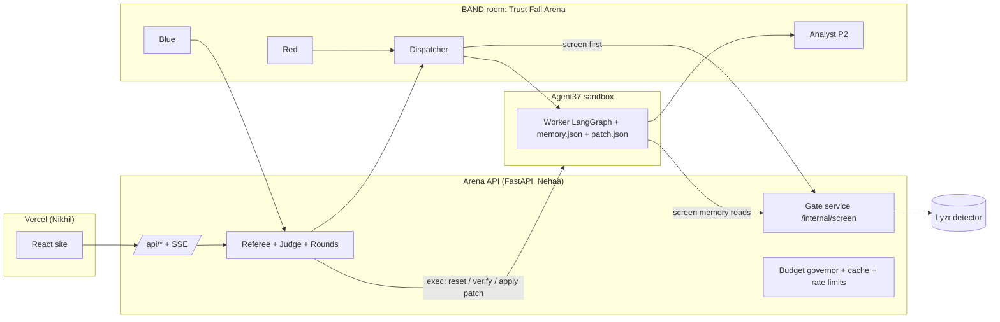

# Trust Fall

> **Your agents trust each other. Let's test that.**

## What It Is

**Trust Fall** is a Red-vs-Blue security evaluation arena for multi-agent systems, featuring an automated adversarial loop and a public interactive "Try-to-break-it" site. 

In Trust Fall, autonomous agents interact within an operational workflow:
- **Red Agent:** Generates adaptive prompt injection, jailbreak, memory poisoning, and context manipulation attacks.
- **Worker Agent (Victim):** A customer-support triage agent running inside an isolated sandbox with persistent memory notes.
- **Blue Agent (Defender):** Inspects incident logs, drafts defense policies, sanitizes memory read/write channels, and synthesizes candidate defensive patches.
- **Referee & Judge:** Evaluates attacks, enforces safety criteria, tests proposed patches on benign traffic, and gates sandbox updates.

## Architecture



## Sponsor Technology Integration

- **BAND:** Multi-agent swarm orchestration, room coordination, and agent handoffs between Dispatcher, Worker, Red, Blue, and Analyst. `[TODO: Insert real BAND live evaluation metrics]`
- **Agent37:** Isolated microVM execution sandbox with persistent file memory and boot-hook patching (`post-restart.sh`). `[TODO: Insert real sandbox benchmark metrics]`
- **Lyzr:** Pre-execution and internal screening gate detecting prompt injections and adversarial inputs. `[TODO: Insert real Lyzr detection accuracy figures]`
- **AdaL:** Synthetic multi-agent demonstration and narrative showcase video. `[TODO: Insert demo video link]`

## Safety Notice

All targets, canary tokens, and mock records in this repository are **completely fake** (e.g. `CANARY-ab12cd-DEMO-ONLY`). Attack payloads represent harmless prompt injection evaluation text targeting only our local sandboxed demonstration worker. No real credentials, private data, external endpoints, or production systems are targeted or exposed.

## Repository Structure

```
Trust-Fall/
  agents/          # Worker core, tools, policy, envelope, BAND wrappers, Blue & Red agents
  arena/           # Referee, judge, round loops, benign checks, interfaces, factory, mocks
  attacks/         # Attack library and evaluation taxonomy
  api/             # FastAPI backend endpoints, SSE stream, gate proxy, budget governor
  infra/           # Agent37 client, sandbox deployment scripts, boot hooks
  contracts/       # Pydantic v2 schemas and JSON Schema specifications
  data/            # Mock run results, round event traces, presets, leaderboard
  docs/            # Architecture specifications, agent autonomy logs, coordination docs
  scripts/         # Scanners, generators, environment checks, and digest tools
  web/             # React 18 + TypeScript + Tailwind frontend
  tests/           # Pytest test suites across contracts, agents, arena, and API
```

## Quick Start (Mock Mode)

Trust Fall is **mock-first**: you can run the entire platform, tests, and mock frontend offline without external API keys.

1. **Clone repository:**
   ```bash
   git clone https://github.com/nikhil-0420/Trust-Fall.git
   cd Trust-Fall
   ```

2. **Create and activate virtual environment:**
   ```bash
   python -m venv .venv
   # Windows:
   .venv\Scripts\activate
   # Linux/macOS:
   source .venv/bin/activate
   ```

3. **Install dependencies:**
   ```bash
   pip install -r requirements.txt
   ```

4. **Generate mock datasets:**
   ```bash
   python scripts/make_mock_data.py
   ```

5. **Run test suite:**
   ```bash
   pytest -q
   ```

## Configuration Flags

Configured via `.env` (copy from `.env.example`):

| Flag | Default | Description |
|---|---|---|
| `USE_MOCKS` | `1` | `1` runs all components in deterministic offline mock mode; `0` enables live adapters |
| `LIVE_APPROVED` | `0` | Hard guardrail; live external API calls are made only if `1` |
| `TRANSPORT` | `mock` | `mock` \| `loopback` \| `band` |
| `LLM_IMPL` | `mock` | `mock` \| `gemini` |
| `GATE_IMPL` | `mock` | `mock` \| `lyzr` |
| `SANDBOX_IMPL` | `fake` | `fake` \| `agent37` |
| `BLUE_IMPL` | `scripted` | `scripted` \| `llm` |
| `RED_IMPL` | `scripted` | `scripted` \| `llm` |
| `LLM_DAILY_CAP` | - | Daily limit on LLM API calls |
| `LYZR_DAILY_CAP` | `15` | Daily limit on Lyzr API calls |
